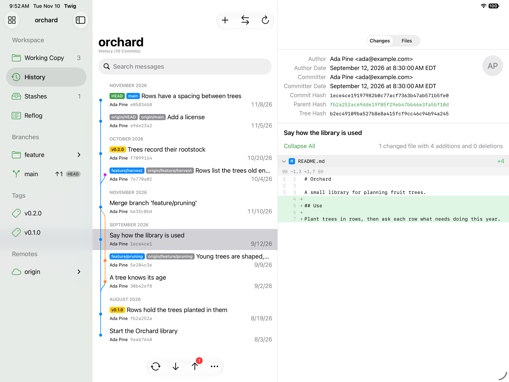

# Wye

A git client for macOS and iOS, written in SwiftUI. Free, and open source
under the Apache License 2.0.



Wye is built for the App Store, so it runs in the sandbox and does not use
the `git` command line tool. Everything goes through
[libgit2](https://libgit2.org), compiled from source into the app. SSH
connections are made in Swift with
[SwiftNIO SSH](https://github.com/apple/swift-nio-ssh), on CryptoKit.

## What works

- **Repositories:** open one from any folder, or clone one over HTTPS or SSH.
- **Sidebar:** branches grouped into folders, tags, remotes, stashes,
  submodules, worktrees and the reflog, with ahead/behind counts; branches
  can be pinned to the top or archived out of the way, and are marked when
  merged into the main branch or stale. Every row has a full context menu,
  on iOS by a long press.
- **History:** a commit graph with reference badges, read a page at a time;
  search by message, author, hash or path; compare two commits or branches;
  export a commit's, branch's or tag's files as a zip.
- **Commit detail:** the changes as diffs, or the files at that commit; file
  history and blame.
- **Working copy:** stage and unstage files, hunks or single lines; discard;
  commit and amend; stash, or snapshot the changes and keep them in place;
  compare the working tree, the index and `HEAD` as a whole; resolve conflicts. Changed files as a list or a
  folder tree; ignore, stop tracking, rename, trash or restore a file from
  its menu; commit templates and recent messages; diff options for context
  lines and whitespace.
- **Branching:** merge, rebase, cherry-pick, revert and reset, onto any
  revision picked by name or typed; create, rename and delete branches and
  tags; a branch from a stash.
- **Submodules:** initialize, update (recursively), fetch, synchronize, add,
  move, change URL and remove; check out a revision inside one; open one as a
  repository; a submodule's change in a diff lists the commits it brings.
- **Worktrees:** add one for a branch, a new branch or a commit; lock, move,
  remove and prune; open one as a repository.
- **Remotes:** fetch, pull (merge, rebase or fast-forward only, stashing
  local changes around it) and push with progress, sync, push to any remote
  and name, push any commit to any remote branch, prune a remote without
  fetching, publish and delete tags and remote branches, open remotes,
  branches and commits on their website and start pull requests there;
  access tokens kept in the Keychain.
- **SSH:** `ssh://` and `user@host:path` remotes, logging in with Ed25519 or
  ECDSA keys created in Wye or imported from an OpenSSH key file, kept in
  the Keychain; unknown or changed host keys are shown before connecting.
  RSA keys are not supported.
- **App:** notices changes other tools make and refreshes; a full menu bar
  and keyboard shortcuts, also on iPad; window tabs on macOS (⌘T); quick open (⇧⌘O) for branches, tags
  and repositories; repository groups, search and sorting.

See [docs/roadmap.md](docs/roadmap.md) for what comes next,
[docs/missing-features.md](docs/missing-features.md) for everything not built
yet, and [docs/app-store.md](docs/app-store.md) for how releases are made.

## Building

Requires Xcode 27 or later. The first build fetches the Swift packages SSH
is built on, at the versions pinned in `Package.resolved`.

```bash
git clone --recurse-submodules <this repository>
```

```bash
make run
```

Or open `Wye.xcodeproj` and run the Wye scheme on a Mac, iPhone or iPad.
`make test` runs the engine's tests and `make ios` builds for the simulator.

## Layout

| Path | What it is |
| --- | --- |
| `App/` | The app target: an entry point, plists, entitlements and assets. |
| `Sources/GitKit/` | The git engine: a Swift API over libgit2. No interface code. |
| `Sources/WyeUI/` | The whole interface, shared by macOS and iOS. |
| `Tests/GitKitTests/` | Tests that check GitKit against the command line git. |
| `Vendor/libgit2/` | libgit2, as a git submodule. |
| `Vendor/Clibgit2/` | The build configuration and module map that let Swift Package Manager compile libgit2, and the C half of the SSH transport. |
| `Vendor/ThirdPartyLicenses/` | The licence texts of the Swift packages the app links, copied into the app. |

Platform differences are kept to one file,
`Sources/WyeUI/Support/Platform.swift`.

## Licenses

Wye is licensed under the Apache License 2.0; see [LICENSE](LICENSE).

libgit2 is licensed under the GNU GPL version 2 with a linking exception that
permits linking it into programs under other licenses. It is included as a
submodule, not copied into this repository, and is used unmodified. See
`Vendor/libgit2/COPYING`.

SwiftNIO, SwiftNIO SSH, SwiftNIO Transport Services, Swift Crypto, Swift
Atomics and Swift Collections are Swift packages under the Apache License
2.0, fetched by Swift Package Manager; their licences are in
`Vendor/ThirdPartyLicenses/`.
